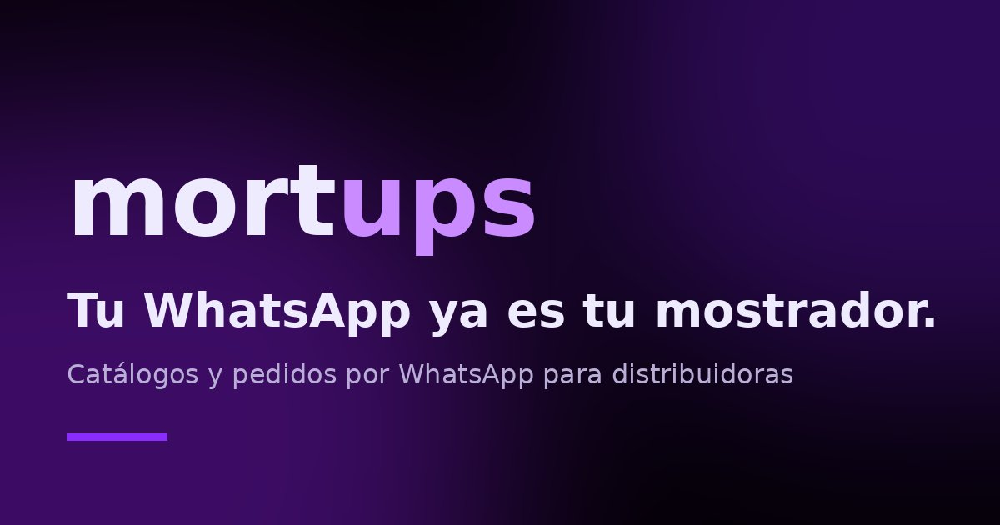
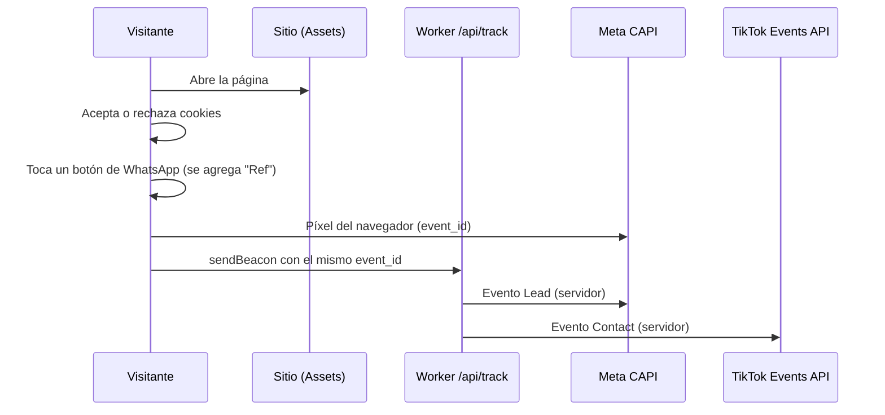

<div align="center">

# mortups

**Catálogos web y pedidos armados por WhatsApp para negocios de Argentina.**
<br>Sitio comercial propio: estático, liviano y medible, con un Worker que envía conversiones al servidor y un banner de consentimiento que respeta la decisión del visitante.

[](https://mortups.com.ar)




</div>

## ¿Qué es?

mortups es mi emprendimiento: armo catálogos web, menús y pedidos por WhatsApp para comercios, distribuidoras y gastronomía. Este repo es **el sitio con el que lo vendo**, y también un caso real de producto: oferta, precios, textos legales para Argentina y medición, todo en producción.

## Qué tiene

- **Rápido y simple.** Menos de 0,5 MB en total, sin framework, sin paso de build y con un solo archivo JavaScript propio.
- **Medición con consentimiento.** Google Analytics, Google Ads, Meta Pixel y TikTok Pixel no se cargan hasta que el visitante acepta. Si rechaza, no se activa nada.
- **Conversiones del lado del servidor.** Un Worker de Cloudflare envía el evento a la Conversions API de Meta y a la Events API de TikTok, con el mismo `event_id` que el navegador para que no se cuente dos veces.
- **Atribución de ventas por WhatsApp.** Cada clic agrega un código `Ref` al mensaje; cuando se cierra la venta, ese código permite subirla como conversión offline.
- **Seguridad.** Política CSP estricta, `X-Frame-Options`, `Referrer-Policy`, `Permissions-Policy` y `nosniff`; el Worker valida el origen y limita los campos que acepta.
- **SEO y compartir.** Datos estructurados (JSON-LD), sitemap, robots, Open Graph y Twitter Cards.
- **Legales para Argentina.** Privacidad, términos, cookies y trámites de arrepentimiento y baja.

## Cómo funciona la medición



Si el visitante rechaza las cookies, no se envía ningún evento, ni del navegador ni del servidor.

## Stack

| Capa | Tecnología |
|---|---|
| Hosting y edge | Cloudflare Workers + Static Assets |
| Frontend | HTML y CSS a mano, un archivo `track.js` |
| Servidor | Worker en JavaScript (`src/worker.js`) |
| Medición | Google tag, Meta Pixel y CAPI, TikTok Pixel y Events API |

## Estructura

```
public/
  index.html        página principal
  track.js          consentimiento + eventos
  _headers          CSP y cabeceras de seguridad
  cookies/ privacidad/ terminos/
  img/
src/worker.js       POST /api/track → Meta y TikTok
wrangler.jsonc      assets + run_worker_first en /api/*
```

## Correrlo en local

```bash
npx wrangler dev
```

Abre `http://localhost:8787`. Necesita Node.js.

## Configuración

1. En `public/track.js` completá `C` con los IDs públicos (GA4, Ads, Meta, TikTok). Sin IDs no se carga nada ni aparece el banner. `public/demo.js` maneja los ejemplos interactivos de la portada.
2. En `wrangler.jsonc` cargá `META_PIXEL_ID` y `TIKTOK_PIXEL_ID` (variables).
3. Los tokens son secretos y no se suben al repo:
   ```bash
   npx wrangler secret put META_TOKEN
   npx wrangler secret put TIKTOK_TOKEN
   ```
   Para pruebas locales usá un archivo `.dev.vars` (ya está en `.gitignore`). Los códigos `META_TEST_CODE` y `TIKTOK_TEST_CODE` permiten ver los eventos en las herramientas de prueba de cada plataforma.
4. Deploy: `npx wrangler deploy`.

## Decisiones de diseño

- **Estático y sin framework**: carga rápida y cero build. A cambio, no hay componentes reutilizables.
- **El Worker corre solo en `/api/*`** (`run_worker_first`), así que el resto se sirve directo como archivos estáticos.
- **Navegador y servidor con el mismo `event_id`**, que es la forma que usan Meta y TikTok para deduplicar.
- **GA4 no se envía por servidor** para no duplicar eventos; se mide desde el navegador.
- **La venta se cierra en WhatsApp, no en el sitio**: un clic no es una venta. Por eso el código `Ref`.
- **Consentimiento primero**: nada se carga ni se envía antes de aceptar.

## Límites y próximos pasos

- Mide clics a WhatsApp, no ventas; la importación de conversiones offline es manual.
- No hay tests automatizados todavía.
- Los IDs de medición no están cargados en este repo público.
- Próximo: páginas por rubro, testimonios de clientes y dominio propio.

## English summary

A production sales site for my web and WhatsApp-ordering service in Argentina. Static, dependency-free, deployed on Cloudflare Workers, with a consent banner, a Worker that sends deduplicated server-side events to Meta Conversions API and TikTok Events API, strict CSP headers and Argentina-specific legal pages.

## Licencia y autor

© 2026 Lautaro Mortarotti. Código publicado para mostrar mi trabajo; todos los derechos reservados.

Hecho en Mendoza, Argentina · [@themortamc](https://github.com/themortamc) · [mortups.com.ar](https://mortups.com.ar)
